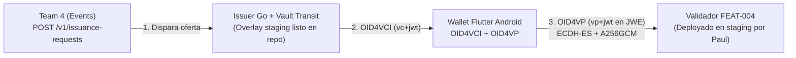

# Mapa de Integración End-to-End: Issuer + Wallet + Verifier + Staging

Actualizado: 2026-11-23. Consolida el camino técnico para integrar el trabajo del **Emisor (`FEAT-005`)**, la **infraestructura staging de Mau (`ISS-T11`)**, la **Wallet Flutter (`src/wallet`)** y el **Validador desplegado por Paul Tarazona (`FEAT-004` en `https://hukid.zentrycore.com`)**.

Documentos base relacionados:
- Progreso y estado de ramas: [issuer-wallet-progress-and-next-steps.md](./issuer-wallet-progress-and-next-steps.md)
- Arquitectura y operación de staging: [staging-architecture.md](./staging-architecture.md), [staging-operations.md](./staging-operations.md), [staging-verification.md](./staging-verification.md)
- Desarrollo local y operación Issuer: [local-development.md](../04-engineering/local-development.md), [issuance-operations-and-pitr-runbook.md](../04-engineering/issuance-operations-and-pitr-runbook.md), [tasks.md](../features/FEAT-005-issuer-operations/tasks.md)
- Contrato del validador desplegado en upstream: `` `upstream/develop:docs/03-design/verifier-integration-guide.md` ``

---

## Panorama de los 5 frentes de integración

---

### Etapa 1 — Emisor OID4VCI + Wallet (Completada en repo)
- **Backend Issuer (`src/platform` + `src/console`):** OID4VCI 1.0 completo (`/{slug}/.well-known/openid-credential-issuer`, `POST /oauth2/token`, `POST /{slug}/nonce`, `POST /{slug}/credential`, `POST /{slug}/deferred_credential`), Bitstring Status Lists, Vault Transit KMS (`vaultkms`), dashboard, comandos operator (`suspend`, `reactivate`, `revoke`), workers (`deferred`, `retention`), DLQ replay y runbook PITR.
- **Wallet OID4VCI (`src/wallet`):** puente nativo `AndroidKeyStore` (llaves ECDSA P-256 no exportables y bóveda cifrada AES-256-GCM en `MainActivity.kt`), `Oid4vciOfferAdapter` en Dart puro y manejo de deep links `openid-credential-offer://`.

---

### Etapa 2 — Wallet OID4VP ↔ Validador de Paul (`src/wallet`)
Para cerrar el circuito hacia el Validador desplegado en `https://hukid.zentrycore.com` (descrito en `` `upstream/develop:docs/03-design/verifier-integration-guide.md` ``), la Wallet implementa el perfil exacto esperado por `internal/oid4vp` e `internal/verification`:
1. **Deep Link `openid4vp://`:** declarado en `AndroidManifest.xml` y enrutado en `MainActivity.kt` hacia `PresentPage` en `src/wallet/lib/main.dart`.
2. **Consulta de Request Object (`Oid4vpPresentationAdapter.fetchRequest`):**
   - Parsea `openid4vp://authorize?client_id=...&request_uri=...` (`https` obligatorio en producción/staging; loopback opt-in mediante `HUKID_ALLOW_INSECURE_LOOPBACK`).
   - Solicita `GET request_uri` (`Accept: application/oauth-authz-req+jwt`) y valida `typ=oauth-authz-req+jwt`, `alg=ES256`, `aud=https://self-issued.me/v2`, `response_type=vp_token`, `response_mode=direct_post.jwt`, `dcql_query` con formato `application/vc+jwt` y `client_metadata` con JWK EC P-256 (`use=enc`, `alg=ECDH-ES`, `A256GCM`).
   - Verifica la firma ES256 del Request Object cuando se provee la llave pública del verifier (`verifierSigningKeys`). Nota: el Validador en staging aún no adjunta cadena `x5c` en el header, por lo que la llave de verificación del Request Object se obtiene fuera de banda (`kid` actual en staging documentada por upstream: `a806f17ef7a79ce50a55c0dee77baf6b`).
3. **Construcción de Presentación `vp+jwt` (`buildVerifiablePresentationJwt` en `crypto_p256.dart`):**
   - Header: `alg=ES256`, `typ=vp+jwt`, `jwk` pública P-256 del holder (cuyo thumbprint RFC 7638 coincide con `cnf.jkt` de la credencial).
   - Payload VCDM 2.0: `@context` `["https://www.w3.org/ns/credentials/v2", "https://schemas.hukid.pe/contexts/presentation/v1"]`, `type: ["VerifiablePresentation"]`, `aud` igual al `client_id` del request, `nonce` del request y `verifiableCredential` con `EnvelopedVerifiableCredential` (`data:application/vc+jwt,<vc>`).
4. **Cifrado JWE en Dart puro (`crypto_jwe.dart`) y envío (`POST /oid4vp/response`):**
   - Cifra `{"vp_token":{"<id>":["<vp+jwt>"]},"state":"<state>"}` como JWE compacto con `ECDH-ES` (NIST SP 800-56A Concat KDF SHA-256, P-256 efímera en `epk`) y `A256GCM` (AES-256-GCM).
   - Envía `application/x-www-form-urlencoded` con parámetro `response=<JWE>` a `response_uri`.

> [!IMPORTANT]
> **Perfil obligatorio de la credencial para pasar el Validador actual en staging:**
> Según la guía de integración de `upstream/develop`, el Validador en `staging` aún no tiene activadas las comprobaciones `VER-T09` (Status List) ni `VER-T13` (Definition Registry), ni `VER-T12` (JWKS remoto):
> 1. Si una credencial declara `credentialStatus`, `credentialSchema` o `@context` adicional fuera del base VCDM 2.0, el Validador actual responde `fail` (`skipped.not_implemented`). Por ello, para las pruebas piloto contra el Validador actual de staging, la definición publicada en el Emisor debe configurarse con **`publishSchema: false`**, **`statusPurposes: []`** y **`contexts: []`** (manteniendo únicamente `https://www.w3.org/ns/credentials/v2`).
> 2. La clave pública P-256 del Emisor (`{"issuer": "...", "kid": "...", "jwk": {...}}`) debe registrarse en `deploy/staging/issuer-keys.json` del Validador hasta que `VER-T12` quede integrado.

---

### Etapa 3 — Conciliación Git y de Migraciones con `upstream/develop` (Completada en `origin/develop`)
Al integrar `feat/wallet-oid4vci-integration` (`4e4fee1`) con `upstream/develop` (`26fa455`):
1. **Colisión resuelta en la migración `0015`:**
   - `upstream/develop` ya había aplicado `0015_verification_maintenance.sql` en staging (login de mantenimiento para purga de verificación).
   - Para preservar el historial inmutable en staging, se conservó `0015_verification_maintenance.sql` sin cambios y se renumeraron las 4 migraciones del Emisor a **`0016_issuer_foundation.sql`**, **`0017_issuance_core.sql`**, **`0018_status_lists.sql`** y **`0019_etapa_a_lifecycle_and_schemas.sql`** (19 migraciones en total).
2. **Conciliación aditiva completada:**
   - Infraestructura staging: `deploy/staging/Caddyfile`, `deploy/staging/compose.yaml`, `scripts/staging-secrets.mjs`, `scripts/staging-secrets.test.mjs`, `src/platform/cmd/stagingdb/main.go`, `src/platform/internal/adapters/postgres/staging_provision.go`.
   - Consola y auth: `src/console/src/navigation.ts`, `src/console/src/shell/Shell.tsx`, `src/console/src/authentication/AuthConsole.tsx`, `src/platform/cmd/api/auth.go`.
   - Tests y docs: `persistence_integration_test.go`, `browser_integration_test.go`, `api-contracts.md`, `staging-architecture.md`, `staging-operations.md`.

---

### Etapa 4 — Activación del Overlay del Issuer en Staging (Trabajo de Mau en Dokploy)
Los archivos preparados en el repo esperan ejecución en el servidor VPS/Dokploy siguiendo [staging-operations.md](./staging-operations.md) y [staging-verification.md](./staging-verification.md):
1. Configurar Vault Transit externo con KEK `aes256-gcm96` (`derived=true`, `exportable=false`) y generar `HUKID_ISSUANCE_CLAIMS_KEY_CIPHERTEXT` mediante [wrap-staging-claims-key.mjs](../../scripts/wrap-staging-claims-key.mjs).
2. Ejecutar herramientas (`migrate` + `runtime-logins` + `bootstrap`) desde el compose base para crear el login aislado `hukid_staging_issuance` y aplicar migraciones `0015`–`0018`.
3. Componer `deploy/staging/compose.yaml` + [compose.issuer.yaml](../../deploy/staging/compose.issuer.yaml) con la CA TLS de PostgreSQL (`HUKID_POSTGRES_CA_FILE`), confirmar rutas de [Caddyfile](../../deploy/staging/Caddyfile) y activar el perfil `issuer-workers` (`deferred-worker` y `retention-worker`) tras fijar `HUKID_ISSUANCE_TENANT_ID`.

---

### Etapa 5 — Cierre E2E Externo y Operación (`Team 4` + APK + PITR)
1. **APK Android real:** compilar imagen `hukid-wallet-dev:local` con [deploy/wallet/Dockerfile](../../deploy/wallet/Dockerfile) (`target: development`), probar en dispositivo/emulador la firma `AndroidKeyStore`, la bóveda AES-GCM y el ciclo completo `openid-credential-offer://` → `openid4vp://` contra staging.
2. **Team 4 (Events):** conectar su adaptador outbound a `POST /oauth2/token` y `POST /v1/issuance-requests` usando un cliente M2M provisionado en Consola.
3. **Operación nube (`HK-055` y `HK-056`):** ejecutar drill PITR real de PostgreSQL + consistencia con Vault Transit y ejecutar pruebas de carga/conformance sobre HTTPS.
