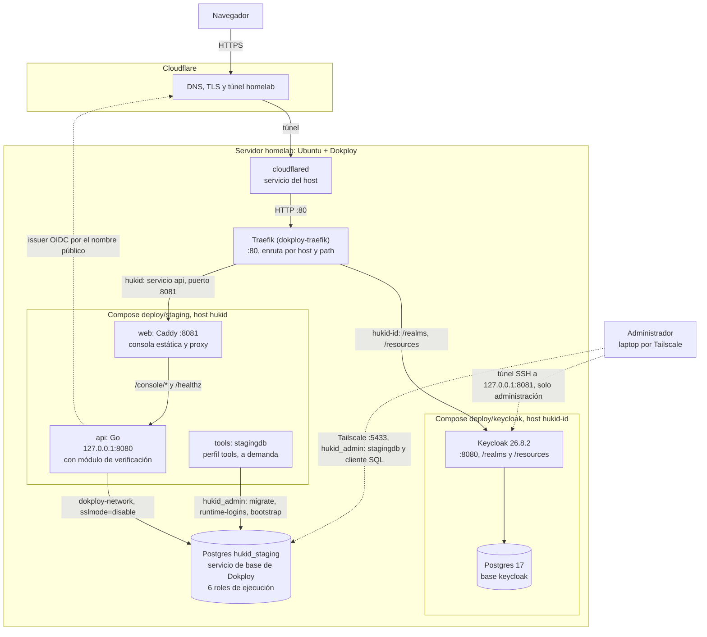

# Arquitectura de staging desplegada en Dokploy

Estado: descripción de lo que corre desde 2026-11-10, con el módulo de verificación por tenant (FEAT-004) montado desde 2026-11-19; no autoriza producción. [ADR-0029](../decisions/ADR-0029.md) registra las decisiones y los límites hacia producción. Fuentes: [`deploy/keycloak/docker-compose.yml`](../../deploy/keycloak/docker-compose.yml), [`deploy/staging/compose.yaml`](../../deploy/staging/compose.yaml) y [`deploy/staging/Caddyfile`](../../deploy/staging/Caddyfile). No contiene secretos ni valores de entorno.

## Diagrama

Línea continua: tráfico de datos. Línea punteada: consulta de identidad o administración.

## Componentes

| Componente | Rol | Notas |
| --- | --- | --- |
| Cloudflare | DNS, TLS y túnel `homelab` | Las rutas `hukid-id` y `hukid` apuntan a `http://localhost:80`. |
| `cloudflared` | Cliente del túnel | Servicio del host (systemd), no un contenedor. |
| Traefik | Entrada HTTP del servidor | Contenedor `dokploy-traefik`, puerto 80 del host. |
| Keycloak | IdP OIDC, realm `hukid` | 26.8.2 con `start`. `KC_HOSTNAME` es la URL pública; la administración solo escucha en `127.0.0.1:8081` del host. |
| Postgres de Keycloak | Base `keycloak` | Volumen `keycloak-db-data`, red `default` del compose, sin puerto publicado. |
| `web` | Caddy: consola estática y proxy | Escucha en 8081 dentro del espacio de red de `api` (`network_mode: service:api`). Sin puertos publicados. |
| `api` | Backend Go | `127.0.0.1:8080`, `HUKID_ENV=staging`. Healthcheck con el subcomando `hukid-api healthcheck`. Monta el módulo de verificación por tenant (lectura de sesiones para la consola); si falta alguna de sus variables o el login `hukid_staging_verification`, no arranca. |
| `tools` | `stagingdb`: `migrate`, `runtime-logins`, `bootstrap` | Perfil `tools`: solo corre con `docker compose --profile tools run`. Usa el propietario `hukid_admin`. |
| Postgres `hukid_staging` | Base de HukID | Servicio de base de Dokploy `hukid-staging-db-ggfxdz:5432` dentro de la red de Dokploy. Seis logins de ejecución con RLS (`session`, `context`, `tenant`, `members`, `dashboard`, `verification`; [ADR-0029](../decisions/ADR-0029.md), punto 3) y 15 migraciones aplicadas (`0001` a `0015`). Un séptimo login, `hukid_staging_verification_maintenance`, solo ejecuta la purga de retención de la verificación (la API no lo usa). Además de la red de Dokploy, la base se alcanza por un puerto externo (5433) a través de Tailscale; se usó con `hukid_admin` para ejecutar `stagingdb` desde una laptop y para el cliente SQL. |

## Rutas públicas

| Host | Path | Destino | Dónde se configura |
| --- | --- | --- | --- |
| `hukid-id.zentrycore.com` | `/realms`, `/resources` | Keycloak, puerto 8080 | Etiquetas de Traefik en `deploy/keycloak/docker-compose.yml`. |
| `hukid-id.zentrycore.com` | `/admin` y el resto | Sin ruta: 404 de Traefik | No se enruta a propósito. |
| `hukid.zentrycore.com` | Todos | Servicio `api`, puerto 8081, atendido por `web` | Pestaña Domains de Dokploy (no versionado). |

Dentro de `web`, `/console/*` y `/healthz` pasan a `api`; el resto sirve el build estático con `index.html` como respaldo.

El `Caddyfile` enruta a la `api`, además de `/console/*` y `/healthz`, solo las rutas del wallet (`/oid4vp/request/*`, `/oid4vp/response`) y los endpoints de sesiones de verificación de la API de operador con Bearer (`/v1/operator/tenants/{id}/verification-sessions` y `.../{sessionId}`), con `Cache-Control: no-store`. El resto de `/v1/operator/*` (por ejemplo `/me`) no se enruta y cae en el respaldo estático. La autenticación de cada ruta la hace la `api` (wallet por identificador y `state` de un solo uso; operador por Bearer y step-up). La consola lee las verificaciones por `/console/api/tenants/{id}/verification-sessions`.

## Módulo de verificación

| Pieza | Estado en staging |
| --- | --- |
| Variables de la `api` | `HUKID_VERIFICATION_DATABASE_URL` (se arma en el compose con la contraseña del login), `HUKID_VERIFICATION_KEY`, `HUKID_VERIFICATION_KEY_VERSION` y `HUKID_VERIFICATION_ISSUER_KEYS`; todas obligatorias. |
| Clave maestra | Cifra las claves de firma por tenant ([ADR-0034](../decisions/ADR-0034.md)); no se regenera ni se rota sin un plan. Se genera con `scripts/staging-secrets.mjs`. |
| Emisores de confianza | `deploy/staging/issuer-keys.json` es un marcador con una clave pública sintética: ningún emisor real es de confianza hasta integrar la resolución por JWKS (VER-T12). |
| Datos | Sin sesiones ni configuración de verifier por tenant: la vista Verificaciones está vacía y iniciar sesiones sigue siendo una acción de la API de operador, no expuesta. |

Operación y orden de aprovisionamiento: [staging-operations.md](staging-operations.md).

## Límites de este diagrama

- Se dibujó a partir de los compose y de comprobaciones manuales del 2026-11-10 (discovery de Keycloak con 200, `/healthz` con 204 por Traefik, login de punta a punta). No se contrastó con una exportación de la configuración de Dokploy ni de Cloudflare.
- Viven fuera del repositorio y no están verificadas aquí: el dominio `hukid.zentrycore.com` de Dokploy, las rutas del túnel y la regla de caché de Cloudflare para `/realms/*`.
- Recrear `api` obliga a reiniciar `web`, por `network_mode: service:api` ([operación](staging-operations.md)).
- El realm `master` también responde por `/realms`; su restricción es una propuesta no aplicada ([keycloak-master-realm.md](keycloak-master-realm.md)).
- La verificación de punta a punta contra staging no está ejecutada ([staging-verification.md](staging-verification.md)). El 2026-11-19, tras aplicar `0012`–`0014` y `runtime-logins`, se comprobó `/healthz` 204, la consola 200, `/oid4vp/response` 405 y el login del operador; la vista Verificaciones en staging no se ha recorrido con datos.
- Cada migración nueva o rol de ejecución nuevo debe aplicarse con `stagingdb` antes de redesplegar `api`; si no, la `api` queda `unhealthy` y la consola cae (ocurrió el 2026-11-19 al montar el módulo con la base en `0011`).

Contexto: [ADR-0028](../decisions/ADR-0028.md) define el entorno `staging` del backend.

Volver al [índice del proyecto](../../README.md).
